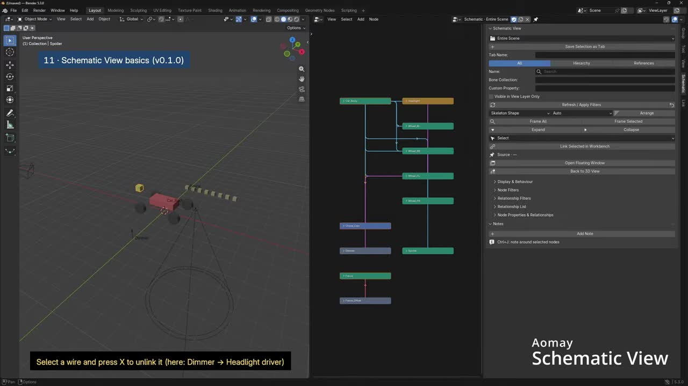

# Blender Schematic View 0.7.0

[繁體中文使用說明](使用說明-繁體中文.md) · [English User Guide](User-Guide.en.md) · [Changelog](CHANGELOG.md)

[Download 0.7.0 · 下載](releases/schematic_view-0.7.0.zip?raw=true)

## Demo video / 示範影片

Watch a short walkthrough of Schematic View.

觀看 Schematic View 的簡短操作示範。

**AI disclosure**　This extension was created by AI and iterated based on user feedback.

**AI 製作聲明**　本外掛由 AI 製作，並依使用者回饋迭代。

Schematic View brings a 3ds Max-style Schematic View to Blender. It shows your whole scene as a node graph and lets you wire up parents, constraints and drivers visually.

- **Whole-scene relationship graph:** every object, with color-coded wires for parent, constraint, driver and modifier/material references. Filter by Hierarchy or References, and the graph refreshes automatically when you add objects.
- **Every bone is its own node:** wire empties or meshes to individual bones (Driver, Copy Location, Damped Track, IK), or link bones to each other (Parent, constraint, driver).
- **Link Workbench:** pick one source and one or more targets, tick their properties, and create a Parent, one of 12 constraint types, or a Driver, with no code. "Links Between These" lists every wire between the loaded items, with Unlink.
- **Relative / Absolute offset:** in Relative mode, targets stay where they are and follow only the change; in Absolute mode they take the source value directly.
- **Auto Units:** angles are written in degrees, angle↔distance is converted automatically, integer targets are rounded and checkbox targets switch at > 0.5.
- **Map Range + Clamp**, plus **its own expression for each target value**: one source can move, spin and scale an object with different formulas.
- **Chain and Copy Once:** source → target 1 → target 2…, or write a value one time with no live driver.
- **Property browser:** custom properties, modifiers, shape keys and materials, for example driving a material's emission.
- **Notes (Ctrl+J):** colored frames with text, saved in the .blend, with jump-to-note.
- **Skeleton Shape layout:** bones are laid out like the rest pose (human, quadruped…), with left side blue and right side red.
- **3ds Max-style keys:** [ parent, ] children, double-click selects the tree, L selects dependents, X deletes a selected wire.

### 中文

Schematic View 把 3ds Max 風格的 Schematic View 帶進 Blender，用節點圖呈現整個場景，Parent、Constraint、Driver 都能用視覺化的方式連起來。

- **整個場景的關係圖：** 所有物件都在圖上，Parent、Constraint、Driver、Modifier／材質參照各用不同顏色的線。可以切換 Hierarchy 或 References 篩選，新增物件時圖會自動更新。
- **每根骨頭都是獨立節點：** 可以讓空物件或網格物件連到個別骨頭（Driver、Copy Location、Damped Track、IK），骨頭和骨頭之間也能互相連動（Parent、Constraint、Driver）。
- **Link Workbench：** 選一個來源、一個或多個目標，勾選屬性，就能建立 Parent、12 種 Constraint 或 Driver，不用寫程式。「Links Between These」會列出載入項目之間的所有連線，可以直接 Unlink。
- **Relative／Absolute 偏移：** Relative 讓目標留在原位、只跟著變化量走；Absolute 直接套用來源的值。
- **Auto Units：** 角度用「度」來寫，角度和距離會自動換算，整數目標會四捨五入，開關目標超過 0.5 就打開。
- **Map Range＋Clamp**，**每個目標值也能有自己的運算式**：一個來源就能用不同公式同時讓物件移動、旋轉和縮放。
- **Chain 和 Copy Once：** 來源 → 目標 1 → 目標 2… 依序串連，或者只寫入一次數值，不留下 Driver。
- **屬性瀏覽：** 自訂屬性、Modifier、Shape Keys、材質都能連，例如驅動材質的 Emission。
- **Note 註解（Ctrl+J）：** 加上帶文字的彩色框，存在 .blend 裡，可以從清單直接跳過去。
- **Skeleton Shape 排版：** 骨頭依照 rest pose 的樣子排列（人形、四足……），左邊藍色、右邊紅色。
- **3ds Max 風格快捷鍵：** [ 選父物件，] 選子物件，雙擊選整棵樹，L 選相依物件，X 刪除選取的連線。

Earlier versions are listed in [CHANGELOG.md](CHANGELOG.md).

## Install

Requires **Blender 5.3 or later**.

1. In Blender, open **Edit → Preferences → Get Extensions**.
2. Open the menu at the top right and choose **Install from Disk**.
3. Select [`releases/schematic_view-0.7.0.zip`](releases/schematic_view-0.7.0.zip?raw=true).
4. In the 3D Viewport, select an object or armature, then press **N → Schematic → Open Schematic View**. The floating window shows the selection and its direct relationships, and creates or switches to that tab. With nothing selected, it opens an empty **No Selection** page.

### 安裝

需要 **Blender 5.3 以上**。

1. 在 Blender 開啟 **Edit → Preferences → Get Extensions**。
2. 從右上角選單選 **Install from Disk**。
3. 選擇 [`releases/schematic_view-0.7.0.zip`](releases/schematic_view-0.7.0.zip?raw=true)。
4. 在 3D Viewport 選取物件或骨架，再按 **N → Schematic → Open Schematic View**。浮動視窗會顯示所選項目及直接關係，並建立或切換到其標籤頁。沒有選取時，會開啟空白的 **No Selection** 頁。

## 標籤頁

- 在圖上選取一個或多個節點，再按右側 **Save Selection as Tab**。選取骨頭時，會把所屬骨架存為分頁範圍。
- 點右側目前的頁名切換其他標籤。用 **Tab Name** 更改顯示名稱。每個標籤各自保存篩選、節點位置及展開狀態，並存入 .blend。
- 若需要整個場景，請在標籤選單選 **Entire Scene Tab**。舊版的場景圖和骨架圖也會出現在標籤選單。

## 檢視與篩選

- 收合的節點只顯示名稱和類型顏色。點節點左側的箭頭展開，可看到類型、骨架、骨頭集合及自訂屬性。展開選取的節點後，側欄的 **Node Properties & Relationships** 會顯示完整自訂屬性和關係明細，明細的箭頭標示關係方向。
- 側欄或右鍵選單的 **Expand Selected** 一次展開所有選取的節點。**Collapse Selected** 一次收合選取的節點。
- Windows 上新開的浮動視窗預設靠左，寬度約主視窗的 31%，高度約 92%。已開啟的浮動視窗沿用目前尺寸。
- 對齊的節點直接相連，錯開的節點以圓角折線連接。藍色是父子關係，橘色是約束，紫色是 Driver，綠色是 Armature Modifier 綁定，灰紫色是骨架到根骨的連線。
- 展開右側 **Node Filters** 或 **Relationship Filters**。點類別按鈕立即隱藏，再點一次恢復顯示。**Node Filters** 也會同步 3D Viewport 的物件和骨頭。**Relationship Filters** 控制圖上的連線。
- 名稱、Bone Collection 和自訂屬性名稱按 **Refresh / Apply Filters** 套用到圖和 3D Viewport。**Visible in View Layer Only** 會依 3D 裡的可見性過濾圖面。
- 點 **Reset Filters** 恢復所有預設篩選，並還原外掛隱藏的物件和骨頭。你原先手動隱藏的項目會保持隱藏。
- 左上角 **Quick Controls** 提示可用右側的 **Show Quick Controls** 開關。
- 在圖上按 **B** 並拖出方框選取，再按 **G** 移動所有選取的節點。用 **Shift + 點擊** 可再選一個節點。
- 點選或框選圖上的節點會在 3D Viewport 選到對應物件。骨頭節點在 Object Mode 會選到骨架，在 Pose Mode 會選到骨頭。從 Pose Mode 選到其他一般物件時，Blender 會切回 Object Mode。
- **Human Layout** 依骨名把頭、軀幹和四肢放在人形對應位置。採正面視角，角色左側顯示在畫面右邊。無法分類的骨頭置於右側，無人形命名的骨架沿父子階層排列。開啟圖面、切換骨架或重新排列時會自動顯示全圖。中鍵平移，滾輪縮放，**Frame All** 或 **Home** 可再次顯示全圖。
- 從 Blender 其他編輯器修改場景後，按 **Refresh / Apply Filters** 更新。從圖內建立的關係會立即反映在圖上。

## 右鍵建立關係

- **選一個節點**。右鍵選 **Add Constraint**，在對話框指定約束目標物件及骨頭。也可建 **Empty**，或從骨架或骨頭節點新增 **Bone**。從骨頭新增時，新骨頭會掛在該骨頭下。
- **選兩個節點**。右鍵選 **Add Constraint**、**Add Driver** 或 **Create Parent Link**。預設作用在目前的作用中節點，對話框可交換來源與作用對象。
- 也可以右鍵選 **Mark as Relationship Source**，再單選作用對象，使用已標記的來源。

### 骨頭編輯

- 同一骨架內選取骨頭後，右鍵 **Bone Edit Tools** 提供斷開、清除父級、Split、Separate Bones、Subdivide、Switch Direction 和 Symmetrize。
- 多選時可直接用 **Disconnect Selected Bones** 斷開骨頭接點並保留父級。要移除父子關係，用 **Clear Parent**。
- 選兩根骨頭可用 **Join / Connect Bones**，預設把作用中的骨頭當子骨，將它的頭接到父骨尾端。對話框可交換方向。
- **Blender Armature Menu** 會進入 Edit Mode 並開啟 Blender 原生骨架選單，可使用名稱、Bone Collections、骨頭設定和刪除等操作。完成後按側欄 **Finish Bone Editing** 回到 Object Mode 並更新關係圖。

### 物件父子關係

在 Object Mode，選兩個物件節點並右鍵開啟 **Object Parenting**。作用中的節點是子物件。可用 **Make Parent without Inverse** 或 **Make Parent without Inverse (Keep Transform)**。選取一個或多個已有父物件的節點，可用 **Clear Parent**、**Clear and Keep Transformation** 或 **Clear Parent Inverse**。

| 操作 | 用途 |
| --- | --- |
| **Create Parent Link** | 將物件掛到物件或骨頭下，或調整同一骨架內的骨頭父子關係。骨頭父子關係會修改骨架的靜置階層。 |
| **Add Constraint** | 建立 Copy Transforms、Copy Location、Copy Rotation、Copy Scale、Child Of、Damped Track 或 IK。IK 的受影響節點須為骨頭。 |
| **Add Driver** | 將物件或 Pose Bone 的單一數值屬性連到另一個數值屬性，可使用 `location`、`scale` 或 `["ik_fk"]` 這類自訂屬性。向量分量索引從 0 開始。已有 Driver 的目標欄位會保留。 |

例如要用控制骨的 `["ik_fk"]` 驅動物件的 Z 縮放，先標記控制骨，再選物件，將 **Source Property** 填成 `["ik_fk"]`、**Driven Property** 填成 `scale`、**Driven Array Index** 填成 `2`。

從 `0.0.00` 升級後，重新開啟 Schematic View 或按 **Refresh / Apply Filters**，現有圖會套用人形排列和收合節點。安裝套件版本為 `0.7.0`，最低 Blender 版本為 5.3。Auto-Rig Pro 骨頭分類參考其[骨架文件](https://www.lucky3d.fr/auto-rig-pro/doc/rig_behaviour_doc.html)。
